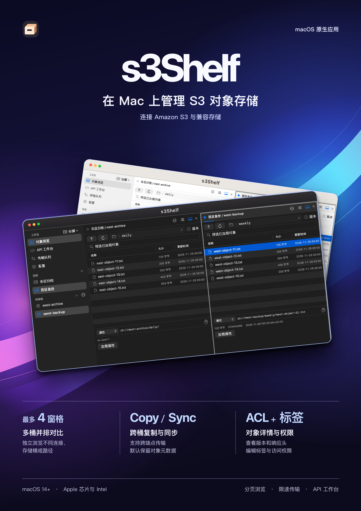

# s3Shelf

s3Shelf 是基于 SwiftUI 和 AppKit 的中文 macOS 对象存储客户端，支持 Amazon S3 和兼容端点。外观默认跟随系统，也可在「配置 → 外观」切换浅色或深色。

<p align="center">
  <a href="docs/images/s3shelf-poster.png">
    
  </a>
</p>

## 功能

- 浏览存储桶和对象前缀，按页加载并短时缓存清单。筛选在本地执行，详情按需请求。
- 在「对象浏览」界面，通过侧栏「工作区」旁或工具栏的「分屏」菜单选择左右分屏或上下分屏，最多同时打开四个对象窗格。新窗格从当前路径打开，可在同一个桶中对比不同路径、在同一连接下对比不同桶，也可切换到其他连接。点选窗格后，侧栏、上传下载和路径快捷键随之切换。
- 每个窗格可独立展开底部详情栏并选择要查看的对象和标签页。工具栏的详情按钮和 `⌥⌘I` 作用于当前窗格。
- 通过侧栏「存储桶」旁的「＋」打开创建表单，填写名称并核对目标连接。创建完成后可直接打开存储桶。遇到端点服务器错误时，应用会查询清单并显示核对结果与可复制的技术详情。
- 在侧栏右键点击存储桶即可删除。确认窗口会显示连接和桶名，并要求再次完整输入桶名。普通 S3 存储桶须先清理对象、历史版本和删除标记。
- 上传、下载、同步和批量删除对象。传输队列支持并发、取消和重试。
- 在「配置 → 传输」设置全局带宽上限和上传分片大小。默认不限速，默认分片 8 MiB。开启全局限速后，传输队列逐项运行。
- 在对象浏览中打开「对象操作 → 同步 → S3 → S3」，再选择 Copy 或 Sync。目标存储桶支持浏览、搜索、分页和手动输入。Copy 保留目标端的其他对象，Sync 在确认后同步目标前缀并删除多余对象。默认保留传输对象的元数据，分片留空沿用全局设置，带宽取全局和任务上限中较低的一项。历史会保留对比数、传输数和传输容量。
- 查看 HTTP 响应头、ACL、标签、对象元数据、历史版本和会话日志，预览文本、图片和二进制内容。
- 在「配置 → 详情缓存」调整标签、权限和响应头共用的缓存时间与空间上限。默认保留 30 秒，空间上限为 32 MiB，也可选择「从不缓存」。命中缓存时显示读取时间，各页可强制刷新。
- 在详情面板编辑存储桶、对象和历史版本的标签和 ACL，管理存储桶策略及公开访问阻止设置。保存前检查端点上的设置是否已变更。
- 使用 AWS Profile、IAM Identity Center、访问密钥、临时凭证或匿名连接。手动输入的密钥由 macOS 钥匙串保存。
- API 工作台可调用内置 AWS CLI v2 的六个 S3 命令组。操作可用性取决于端点、账户权限和存储桶类型。

## 构建

运行环境为 macOS 14 或更新版本。构建需要支持 Swift 6 的 Xcode 工具链、Python 3 和 Go 1.26（可由 Go 自动下载）。构建产物同时包含 Apple 芯片和 Intel 两种架构。

```bash
./build.sh build
open build/s3Shelf.app
```

构建脚本从 AWS 获取固定版本的 AWS CLI v2 安装包，验证 Amazon 安装包签名，再提取 CLI 并生成 API 目录。脚本还会从固定版本的 rclone 源码构建 S3 Copy、Sync 所需的辅助程序。若已有 AWS CLI 安装包，可将其路径作为第二个参数传入。构建输出采用本地临时签名，适合本地运行和验证。

## 项目结构

| 路径 | 用途 |
| --- | --- |
| `Sources/` | 原生界面、浏览与传输状态、详情面板、AWS CLI 调用和凭证处理 |
| `Resources/AppIcon.svg` | s3Shelf「归档抽屉」官方图标源文件 |
| `Resources/AppIcon.icns` | 随 macOS 应用打包的「归档抽屉」图标 |
| `catalog.py` | 根据 AWS CLI 服务模型生成 API 工作台命令目录 |
| `Tools/rclone-s3/` | 构建内置 S3 传输辅助程序 |
| `build.sh` | 生成通用架构的 `s3Shelf.app` |

## 提交约定

提交格式为 `type(scope): 中文主题`。主题用简短的中文动词开头，末尾省略句号。首次克隆后可运行 `git config --local commit.template .gitmessage` 载入模板。
